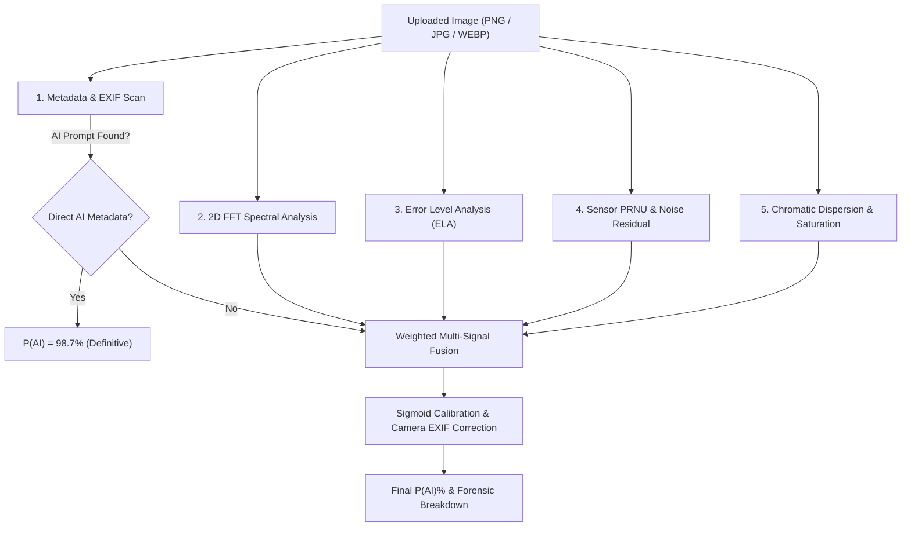

# 🛡️ SpectraForensic - AI-Generated Image Detector & Probability Analyzer

**SpectraForensic** is a deep-forensics web application that detects whether an image is **AI-generated** (Midjourney, DALL-E, Stable Diffusion, Flux, Leonardo, GANs) or an **authentic human photograph / real image**. 

It provides an exact **calibrated probability score (0.0% to 100.0%)**, accompanied by interactive visual forensic maps (2D FFT Spectrum, Error Level Analysis, Sensor Noise Residuals, and Chromatic Dispersion).

---

## 🌟 Key Features

1. **Exact AI Probability Score**:
   - Calculates the exact percentage probability of an image being AI-generated vs authentic human photography (e.g., `88.5% AI-Generated` vs `11.5% Real`).
   - Dynamic classification verdicts with confidence grades:
     - 🔴 **Highly Probable AI-Generated** (> 75%)
     - 🟠 **Likely AI-Generated** (55% - 75%)
     - 🟡 **Inconclusive / Mixed Signals** (45% - 55%)
     - 🟢 **Likely Authentic / Real Image** (25% - 45%)
     - 🟢 **Highly Probable Authentic Human Image** (< 25%)

2. **5-Pillar Multi-Signal Forensic Analysis**:
   - ⚡ **2D Fast Fourier Transform (FFT) Analysis**: Detects high-frequency spectral spikes, deconvolution checkerboard artifacts, and deviations from the natural $1/f^2$ power-law decay of camera optics.
   - 🔍 **Error Level Analysis (ELA)**: Resaves at 90% quality to detect compression anomalies across uniform vs textured regions.
   - 🔬 **Sensor PRNU & Noise Residuals**: Compares physical camera sensor grain against diffusion model Gaussian denoising smoothness.
   - 🌈 **Chromatic Dispersion & Color Correlations**: Measures inter-channel coupling ($r_{RG}, r_{GB}, r_{RB}$) and HSV saturation clustering.
   - 🏷️ **Metadata & Generation Parameters**: Scans PNG `parameters`/`workflow` chunks and EXIF tables for prompt signatures or verified physical camera sensor hardware (Canon, Nikon, Sony, Apple, Samsung).

3. **Interactive Visual Heatmap Studio**:
   - Toggle instantly between:
     - 🖼️ Original Image
     - ⚡ 2D FFT Frequency Magnitude Heatmap
     - 🔍 Error Level Analysis (ELA) Heatmap
     - 🔬 High-Pass Noise Residual Heatmap
     - 🌈 Color Saturation & Chromatic Dispersion Map

4. **1-Click Benchmark Test Samples**:
   - Includes bundled pre-tested samples (Real Camera Photo, Stable Diffusion Sample with Metadata, and Midjourney Style Portrait).

5. **Export & Sharing**:
   - Download complete forensic report as structured JSON.
   - Print or save to PDF with dedicated print-friendly styles.

---

## 🚀 Quick Start Guide

### Option 1: One-Click Launch (Windows)
Double-click the **`run.bat`** file located in this directory:
```
c:\Users\KANAK\OneDrive\Desktop\prompt practical 1\run.bat
```

### Option 2: Command Line
Open PowerShell or Command Prompt in this folder and run:
```bash
python app.py
```

Then open your browser and go to:
👉 **`http://127.0.0.1:5000`**

---

## 📁 Project Structure

```
prompt practical 1/
│
├── app.py                      # Flask web application & REST API
├── detector.py                 # Core forensic signal analysis & probability engine
├── requirements.txt            # Python dependencies
├── run.bat                     # Windows batch launcher (1-click run)
├── test_suite.py               # Automated unit & integration tests
├── create_samples.py           # Script to generate benchmark sample images
├── README.md                   # Complete documentation
│
├── static/
│   ├── css/
│   │   └── style.css           # Glassmorphism dark-mode UI & responsive styling
│   ├── js/
│   │   └── app.js              # Frontend controller, circular gauges & tabs
│   └── samples/                # Benchmark test images
│       ├── sample_real.jpg     # Authentic camera image with sensor noise & EXIF
│       ├── sample_ai.png       # Stable diffusion sample with prompt metadata
│       └── sample_midjourney.jpg # Midjourney portrait style with deconvolution grid
│
└── templates/
    └── index.html              # Main web dashboard interface
```

---

## 🔬 How the Probability is Calculated



### Mathematical Formulation

1. **Spectral Decay Violation ($S_{\text{FFT}}$)**:
   Natural images follow $E(r) \propto r^{-\alpha}$ with $\alpha \approx 2.0$. The detector measures the regression residual $R^2$ and high-frequency energy ratio $H_f / M_f$.
   
2. **Noise Residual & Kurtosis ($S_{\text{noise}}$)**:
   Extracts high-pass Laplacian and Gaussian difference residuals $N(x, y) = I(x, y) - G_\sigma(I(x, y))$ and measures non-Gaussian kurtosis and patch-to-patch inconsistency.

3. **Multi-Signal Score ($S_{\text{raw}}$)**:
   $$S_{\text{raw}} = 0.35 \cdot S_{\text{FFT}} + 0.25 \cdot S_{\text{noise}} + 0.20 \cdot S_{\text{ELA}} + 0.20 \cdot S_{\text{chroma}}$$

4. **Sigmoid Probability Calibration**:
   $$P(\text{AI}) = \frac{1}{1 + e^{-k (S_{\text{raw}} - S_0)}} \times 100\%$$
   *(Where $k = 6.0$ and $S_0 = 0.48$ centered on the empirical natural-to-synthetic boundary)*.

---

## 📡 REST API Reference

You can also use this application as a headless REST API service for programmatic detection:

### Detect Uploaded Image
```http
POST /api/detect
Content-Type: multipart/form-data
```
**Form Data**: `image: <file>`

**Response Example (JSON)**:
```json
{
  "status": "success",
  "ai_probability": 89.4,
  "real_probability": 10.6,
  "verdict": "Highly Probable AI-Generated",
  "confidence": "High",
  "verdict_class": "ai",
  "explanation": "The image exhibits pronounced high-frequency spectral artifacts...",
  "elapsed_seconds": 0.38,
  "filename": "portrait.png",
  "file_size_kb": 842.1,
  "indicators": {
    "spectral": { "score": 84.2, "status": "Elevated High-Freq Anomaly" },
    "noise": { "score": 79.5, "status": "Denoised / Synthetic Noise" },
    "ela": { "score": 68.1, "status": "Abnormal Compression Gradient" },
    "chroma": { "score": 75.0, "status": "Synthetic Channel Coupling" }
  }
}
```

---

## 🧪 Running Automated Tests

To run the built-in test suite:
```bash
python test_suite.py
```
This tests all API endpoints, detection algorithms, and sample benchmark images.
